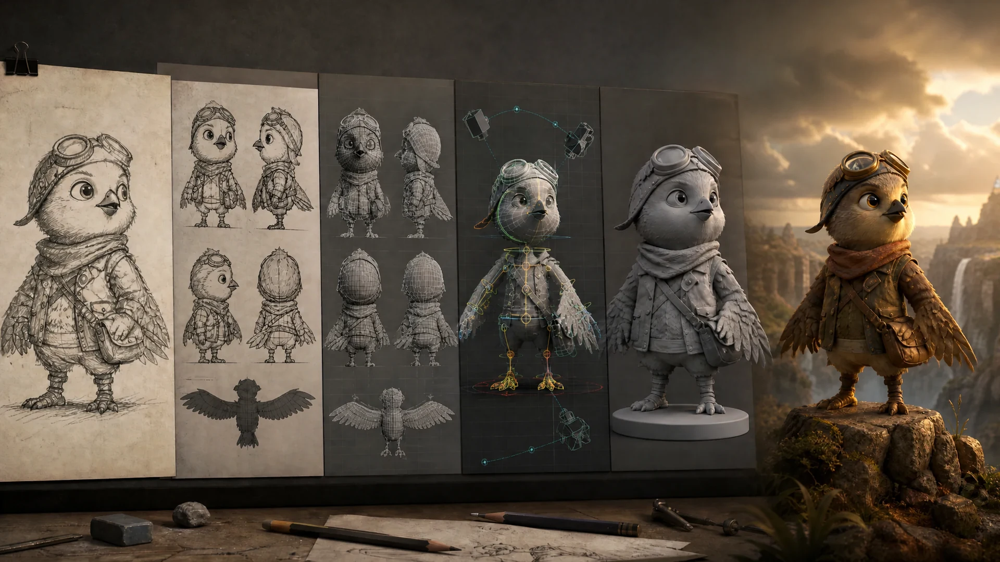

<p align="center">
  
</p>

<h1 align="center">HiAPI Animation Forge</h1>

<p align="center">
  An Agent Skill for planning authorized 2D-to-3D production as a staged, reviewable pipeline.
</p>

<p align="center">
  <a href="./README.md">English</a> | <a href="./README.zh-CN.md">简体中文</a>
</p>

HiAPI Animation Forge turns a 2D image or animation clip into an evidence-driven production plan for 3D assets, rigs, source motion, camera solving, Blender previews, and optional generative rendering. It is designed for Codex, Claude Code, and other Agent Skills-compatible tools.

This is not a one-click "2D video to perfect 3D" claim. Video models remain optional final renderers; they are never treated as deterministic geometry, rigging, camera, or frame-exact motion solvers.

## What It Does

- Analyzes authorized source images and videos by shot, subject, prop, scene, contact, and camera evidence.
- Selects an asset-first reconstruction route based on topology, available views, licensing, and hardware.
- Gates multiview completion, geometry, rigging, skinning, motion solving, camera solving, and compositing separately.
- Produces a deterministic Blender preview requirement before expensive final rendering.
- Supports strict source-lock acceptance tables and explicit result states instead of optimistic completion claims.
- Can route an approved candidate to Seedance 2.0 or Kling only when the selected fidelity contract allows it.

## Production Pipeline

```text
authorized 2D source
  -> shot and asset analysis
  -> character and scene evidence
  -> multiview / geometry candidates
  -> rig, skin, materials and hierarchy
  -> source motion and camera solve
  -> deterministic Blender preview
  -> optional Seedance or Kling render
  -> source-lock QC
```

The local planner creates a production plan only. It does not generate a mesh, rig, Blender scene, or paid video task.

## Fidelity Contracts

| Contract | Use it when | Required behavior |
| --- | --- | --- |
| `frame-exact` | Every source event, pose, contact, camera move, and frame relationship must be controlled | Requires deterministic segmentation/tracking, pose or depth solving, camera solving, rigging/rendering, and compositing; otherwise returns `frame_exact_blocked` before pricing |
| `source-locked` | A source video must preserve event order, timing, framing, blocking, contacts, and prop state | Default for supplied video; prefers the asset-first lane and treats Seedance output as `generated_unreviewed` until full comparison passes |
| `appearance-first` | The target look matters more than source synchronization | Allows newly generated motion from an approved target-world image; Kling requires explicit acknowledgement that synchronization has been abandoned |

Contracts are never silently downgraded.

## Install

Requirements: Node.js 18+ and Git.

```bash
npx -y github:HiAPIAI/hiapi-2d-to-3d-video-skill -y
```

Choose an agent or custom skills directory:

```bash
npx -y github:HiAPIAI/hiapi-2d-to-3d-video-skill --codex
npx -y github:HiAPIAI/hiapi-2d-to-3d-video-skill --claude
npx -y github:HiAPIAI/hiapi-2d-to-3d-video-skill --target=/path/to/skills
```

Existing installations are protected. Add `--force` only when you intentionally want to replace one.

## Quick Start

Plan an authorized source locally without creating assets or spending credits:

```powershell
node scripts/plan-animation-forge.mjs `
  --source-file "D:\media\authorized-shot.mp4" `
  --goal cinematic-video `
  --fidelity source-locked `
  --source-style animation-frame `
  --subject-topology animal `
  --scene-mode dynamic `
  --available-adapter seedance `
  --rights-confirmed
```

Declare an adapter as available only after its executable setup, license, and hardware requirements have been reviewed. See [external adapters](./references/external-adapters.md) and [pipeline architecture](./references/pipeline-architecture.md).

## Asset-First Reconstruction

Use this lane when the deliverable is a rigged asset, Blender-ready scene, or strict reconstruction:

1. Split the source into shots and persistent asset identities.
2. Extract clean evidence, masks, turnarounds, environment plates, and camera anchors.
3. Generate or reconstruct candidate geometry, then reject unseen-side hallucinations and topology breaks.
4. Require stable units, axes, materials, skeletons, skin weights, sockets, hashes, and adapter versions.
5. Validate rig deformation, contacts, prop state, source motion, and camera against the locked timeline.
6. Render and review a deterministic Blender clay preview before any final video-model spend.

AniGen, DrawingSpinUp, Wonder3D, Zero123, img2threejs, Gaussian Splatting, Mesh2Motion, and related tools are external adapters, not bundled dependencies. Their capabilities and licenses must be verified before use.

## Optional Generative Rendering

Generative video is a candidate render stage, not proof of reconstruction.

- **Seedance 2.0 balanced:** eligible for a source-locked candidate with exactly one source video and one approved complete target-world image. Use the sibling [HiAPI Reference Motion Transfer Skill](https://github.com/HiAPIAI/hiapi-reference-motion-transfer-skill).
- **Kling appearance-first:** eligible only after explicit acknowledgement that source synchronization is not required. The bundled CLI then performs local validation, live pricing, approval binding, submission, polling, and result packaging.
- **Veo-class rendering:** not currently submitted by this skill because no executable adapter and request contract are bundled.

Every paid task requires live pricing and explicit approval for the exact unchanged request. The skill never creates an automatic replacement task after a failure.

## Result States

| State | Meaning |
| --- | --- |
| `pipeline_planned` | A local plan exists; no asset or paid task was created |
| `external_setup_required` | A required adapter is unavailable or unverified |
| `frame_exact_blocked` | Deterministic controls are incomplete |
| `asset_candidate_unreviewed` | Geometry or rig exists but artifact QC is incomplete |
| `generated_unreviewed` | A video completed but source comparison is incomplete |
| `source_lock_rejected` | At least one locked source fact differs |
| `source_lock_passed` | Every locked fact passed normal-speed and frame-step review |

Read [output acceptance](./references/output.md) before declaring success and [troubleshooting](./references/troubleshooting.md) before any paid retry.

## Safety And Rights

Use only media, likenesses, logos, models, checkpoints, references, and audio you own or are authorized to use. Do not use the skill for deceptive impersonation or to bypass consent and licensing requirements.

Never claim "3D asset generated," "rigged," "fully synchronized," or "frame-perfect" from a plan, API success response, contact sheet, or convincing sample alone.

## Development

```bash
npm run check
node scripts/plan-animation-forge.mjs --help
node scripts/hiapi-2d-to-3d-video.mjs --help
node scripts/install.mjs --help
```

## License

[MIT](./LICENSE) © 2026 HiAPIAI
